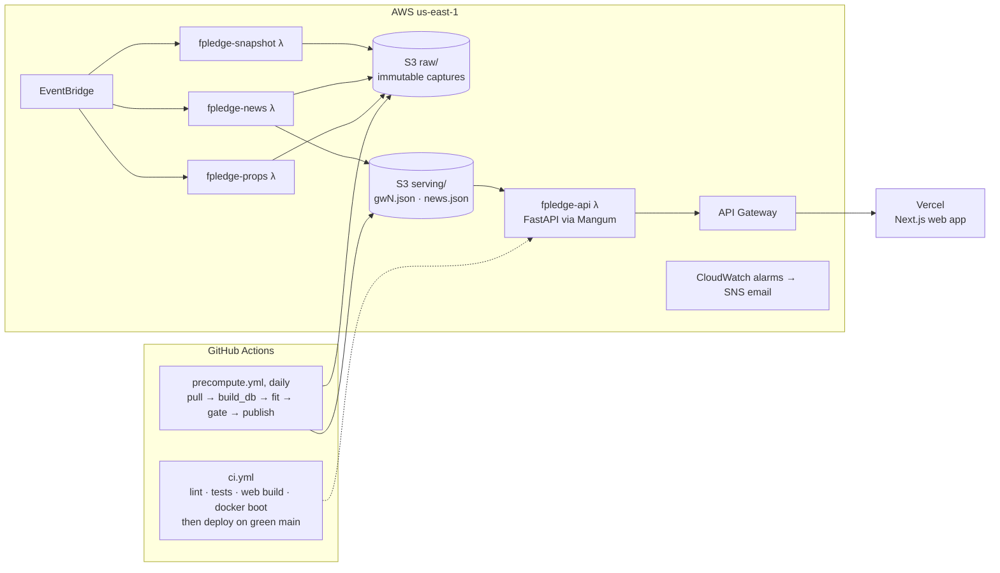

# fpledge

[](https://github.com/derekkuang/Fantasy-Premier-League/actions/workflows/ci.yml)
[](https://github.com/derekkuang/Fantasy-Premier-League/actions/workflows/precompute.yml)

**A Fantasy Premier League prediction system — match engine, expected-points model, squad tools
and a live web app — plus an unusually complete record of what it can and cannot prove.**

A from-scratch Dixon-Coles match engine produces a scoreline probability matrix for every
fixture. A structured expected-points (xP) model turns that into per-player projections, and an
optimiser, transfer suggester and fixture ticker turn those into decisions a manager can make
before a deadline. It runs on AWS, refits daily, and serves a Next.js front end branded
**FPL Edge**.

| | |
| --- | --- |
| Web app | <https://web-lac-phi-16.vercel.app> |
| API | <https://wdvmpi4xw6.execute-api.us-east-1.amazonaws.com> — OpenAPI UI at `/docs` |

The modelling is ordinary football-analytics work. The main point of the repository is the
validation discipline around it. Several findings below are negative results about this
project's own claims. They stay in because deleting them would make the rest untrustworthy.

---

## The honest headline

**The model ranks players better than FPL's own published projection, and that edge does not
translate into a demonstrable points advantage.**

| | result | where |
| --- | --- | --- |
| Our per-gameweek player ranking (played-only Spearman) | **0.361 → 0.378** across four seasons | HANDOFF §27 |
| FPL's own projection, same metric | 0.293 → 0.313 | §16, §27 |
| Does that edge win more points over a season? | **Not demonstrably.** It replicated on ranking and failed to replicate on decisions | §24 |
| Seasons needed to prove a points edge at this effect size | **~30.** Four exist | §26 |

The ranking edge is largest among the 40 most-owned players, which is where a manager's real
decisions happen (§27). It is also small enough that a season's noise swallows it. So the
supported claim is "we rank players better than FPL", never "we win you points".

---

## How it works

The system has two halves with very different costs. A heavy batch job (`numpy`, `scipy`,
`pulp`) fits the models and writes JSON artifacts. A light API reads those artifacts and never
fits anything, so requests are fast and cost stays flat as users grow.

### The model, end to end

```text
football-data.co.uk results, 3 seasons ──► Dixon-Coles MLE (180-day half-life, τ low-score correction)
betting odds (football-data, The Odds API) ──► de-vig ──► market λ, used instead of the engine where a line exists
                                                   │
                                                   ▼
                              per-fixture λ + full scoreline matrix ──► W/D/L · clean sheet · BTTS · O/U
                                                   │
FPL API (players, prices, fixtures, live minutes, ownership)
                                                   ▼
        xP = minutes model × goal/assist shares × λ  + clean sheet + saves + defensive contribution
             + bonus − goals conceded,  scaled by live availability,  per player per gameweek, 8 GWs ahead
                                                   │
          ┌─────────────┬─────────────┬────────────┼─────────────┬──────────────┬───────────────┐
      optimiser    transfers    differentials   true FDR    squad health   projected XI   match briefings
   (ILP: 15→XI→C)  (net of −4)  (xP vs owned)  (from λ)                     (from minutes)  (LLM, guarded)
```

Every model change is judged by a walk-forward harness against realised points and against FPL's
own pre-deadline projection. There's never a shuffled cross-validation, and features at time *T*
only see rows before *T*.

### In production



| job | runs on | when | writes |
| --- | --- | --- | --- |
| **precompute** | GitHub Actions | daily, 04:30 UTC scheduled (GitHub usually starts it hours late) | `serving/gw{N}.json` |
| **snapshot** | Lambda | every 3h; captures only inside 12h of a deadline | FPL's pre-deadline state → `raw/` |
| **props** | Lambda | every 3h, same gate; needs `ODDS_API_KEY` | anytime-goalscorer odds → `raw/` |
| **news** | Lambda | 06:00, 12:00, 18:00 UTC | club news → `raw/`, plus the `/news` digest |
| **api** | Lambda + API Gateway | per request | reads `serving/` only |
| **web** | Vercel | per request, ISR | — |

From a new artifact to a visible page takes up to ~16 minutes: the API's store caches for 60s
and Vercel revalidates within 5–15 min. The precompute refuses to publish a degraded fit (see
`health_check` and `publish_gate` in `fpledge/api/precompute.py`). When it refuses, the
workflow goes red and the previous artifact keeps serving.

### Why the three captures exist

Each one records something the source serves only in the present. A missed day can't be
recovered.

- **snapshot**: FPL's `ep_next`, `chance_of_playing_next_round`, prices and ownership *before*
  each deadline. The community dataset's projection column is scraped after the gameweek and
  contains the result. That contamination made this project believe for four months that it
  lost to FPL (§16). A snapshot is pre-deadline by construction.
- **news**: perfect team news is worth **+0.168** Spearman, against **+0.012** for the best
  modelling change found anywhere in this project (§19). Four sources per club (BBC, Guardian,
  club RSS, the Premier League content API). Feeds are rolling windows, so older items fall off
  permanently (§29–§31).
- **props**: the market's player-level P(scores), which the engine derives rather than
  observes (§22).

---

## Repository tour

| path | what it is |
| --- | --- |
| [`fpledge/`](fpledge/) | The Python package. Everything the product computes lives here |
| [`scripts/`](scripts/) | Command-line entrypoints: production jobs, validation, research. Thin wrappers over `fpledge` |
| [`tests/`](tests/) | 552 pytest tests, ~10s, no network |
| [`web/`](web/) | Next.js 16 · React 19 · Tailwind v4 front end |
| [`infra/`](infra/) | Terraform describing the AWS stack, adopted from hand-built resources via `imports.tf` |
| [`docs/`](docs/) | The research record, the runbook, deploy notes (see [Documentation](#documentation)) |
| [`.github/workflows/`](.github/workflows/) | `ci.yml` (checks, then deploy), `precompute.yml` (daily refit) |
| `Makefile` | Every common command |
| `Dockerfile` | Container path for the API. CI boots it; production uses Lambda zips instead |
| `data/` | *Gitignored.* Local raw zone, DuckDB file, serving artifacts, eval outputs. Created by the pipeline |
| `design_handoff_*/` | *Gitignored.* Design prototypes the page redesigns were implemented from |

### `fpledge/` — the package

#### Top level: the product layer

| module | does |
| --- | --- |
| `gw.py` | **Start here.** Loads inputs, fits the engine, swaps in market λ, and returns records plus the fixture ticker. Everything the precompute serves comes through this file |
| `config.py` | Paths, season, data-source URLs |
| `scoring.py` | FPL 2025/26 scoring rules, including Defensive Contribution |
| `playermeta.py` | Availability, form, price momentum, set-piece takers from the FPL bootstrap. Explanatory only; changes no projection |
| `fdr.py` | True fixture difficulty (1–5) from engine λ, split into attack and defence |
| `transfers.py` · `differentials.py` · `balance.py` | Best single transfer net of −4 · high-xP low-owned players · squad health report |
| `matches.py` · `lineup.py` | Per-fixture scoreline distributions · projected XI from the minutes model |
| `brief.py` | Grounded match briefings: fact pack → LLM → **numeric guard** → template fallback |

#### `models/` — the maths

| module | does |
| --- | --- |
| `dixon_coles.py` | From-scratch Dixon-Coles MLE with time decay and τ correction (not a library call) |
| `match_engine.py` | Team scoring rates → scoreline matrix → every derived market. Stdlib-only |
| `minutes.py` | Start and minutes probability plus the availability factor. The highest-leverage sub-model |
| `shares.py` | How a team's expected goals are attributed to its players |
| `xpoints.py` · `xp_table.py` | xP as pure expected value · per-player records for a gameweek (the `MIN_RECENT_GWS` switch lives here) |
| `saves.py` | Expected goalkeeper saves from shots faced |
| `rank.py` | Effective ownership, differential value, risk tiers (kept in sync with `web/src/lib/risk.ts`) |
| `optimizer.py` | Two-level PuLP ILP: best legal 15 → starting XI → captain |
| `teammap.py` | FPL ↔ football-data club names, including the stable-match map for odds feeds |
| `points_ml.py` | LightGBM points model. **Not in production**: kept as the documented negative result |

#### `ingest/` — getting data in

| module | does |
| --- | --- |
| `fpl_api.py` · `httpget.py` | Throttled client for the unofficial FPL API · the one retrying GET all clients share |
| `landing.py` · `capture_index.py` | Immutable timestamped raw zone on local disk or S3 (same callers) · one index object per capture run |
| `footballdata.py` | Historical EPL results and closing odds; upcoming-fixture odds |
| `oddsapi.py` | The Odds API: goalscorer props, and the 1X2/O-U standby when football-data is down |
| `newsfeed.py` | Four news sources per club, deduped by guid |
| `vaastav.py` | Community per-gameweek history, used by backtests only |
| `understat.py` · `idmap.py` | Shot data and the FPL ↔ Understat identity join. Research path, not production |

#### `api/` — serving

| module | does |
| --- | --- |
| `main.py` | The FastAPI app and every route |
| `precompute.py` | Builds the serving artifact; `health_check` and `publish_gate` block a bad one |
| `store.py` | Reads and writes serving artifacts on disk or S3, with a 60s cache |
| `lambda_handler.py` | Mangum adapter, so the same app runs under uvicorn locally and on Lambda |

#### The rest

| module | does |
| --- | --- |
| `eval/fpl_backtest.py` | **The harness for any xP change.** Walk-forward vs realised points and FPL's projection |
| `eval/backtest.py` · `eval/metrics.py` | Match-model walk-forward vs the de-vigged market · log-loss, Brier, calibration |
| `eval/season_sim.py` | Plays whole seasons under FPL's rules, measuring decisions rather than ranking |
| `eval/snapshots.py` | Reads the pre-deadline snapshots back so the backtest can score availability |
| `eval/news_eval.py` · `eval/brief_eval.py` | Scores the news extractor and builds the `/news` digest · measures the briefing guard's recall |
| `betting/odds.py` · `betting/market_lambda.py` | De-vigging (proportional + Shin) and CLV · market-implied λ from 1X2 + over/under |
| `features/pointintime.py` · `features/build.py` | As-of join primitives and the leakage guard · the DuckDB feature builder |
| `storage/duck.py` · `storage/load.py` | DuckDB schema · landed raw JSON → tables |
| `advisor/agent.py` · `tools.py` · `stub.py` | Squad-advisor tool loop (8-iteration cap) · its five tools · a scripted client for keyless testing |

### `scripts/`

| group | scripts |
| --- | --- |
| Production jobs | `pull_data.py`, `build_db.py`, `precompute.py`, `snapshot.py`, `capture_news.py`, `capture_props.py`, `lambda_captures.py` (Lambda entrypoints for the three captures), `build_lambda.sh` (builds both zips) |
| Setup / one-off | `pull_player_history.py` (once per season, ~558 calls), `verify_landing.py`, `probe_news_feeds.py`, `migrate_index_to_s3.py` |
| Validation | `validate_xp.py`, `validate_multi_gw.py`, `run_backtest.py`, `simulate_season.py`, `build_model_card.py`, `eval_news.py`, `eval_brief.py` |
| Research (kept) | `train_points_model.py`, `returns_model.py`, `model_search.py` |
| CLI demos | `build_xp.py`, `build_squad.py`, `suggest_transfers.py`, `fixture_ticker.py` |

### `web/`

| route | page |
| --- | --- |
| `/` | Landing: paste an FPL team id, or build a squad |
| `/squad` | Build 15 by hand under the real rules; the squad encodes to a shareable `?s=` code |
| `/team/[id]` | A manager's dashboard: pitch view, captain compare, transfers, squad health, advisor chat. `/team/0` is the demo squad |
| `/predictions` | Ranked xP explorer; tap a row for the breakdown |
| `/fixtures` | 8-gameweek true-FDR ticker with split attack/defence cells |
| `/differentials` | Low-owned picks, banded by risk |
| `/news` | Team-news digest (beta) |
| `/model` | The model card, including the negative results |
| `/privacy` · `/terms` | Legal |

[`web/src/lib/api.ts`](web/src/lib/api.ts) is the only file that talks to the backend, and every
response type is declared there. `lib/balance.ts` is a client port of `fpledge/balance.py`. The
components in `web/src/components/` are hand-rolled Tailwind with no UI library.

### The API

```text
GET  /health                              which gameweeks are served
GET  /predictions/{gw}                    per-player xP  ·  /predictions/{gw}/player/{id} for one player's detail
GET  /fixtures/{gw}                       the ticker: λ, FDR and source (market or model) per cell
GET  /matches/{gw}                        scoreline distributions  ·  /matches/{gw}/{id} adds the briefing and both squads
GET  /differentials/{gw}                  high-xP, low-owned
GET  /team/{entry_id}?gw=                 a manager's 15 joined to projections, plus optimal XI and transfers
GET  /news                                team-news digest
GET  /model                               the model card
GET  /advise   ·   POST /advise           advisor status  ·  one conversational turn (the only route that costs money)
```

---

## Running it locally

Needs Python ≥ 3.11 (CI uses 3.13) and Node 22.

```bash
make setup      # .venv + pip install -e ".[dev,api]"
make test       # 552 tests
make lint
```

First run on a fresh clone. Everything lands in the gitignored `data/`:

```bash
.venv/bin/python scripts/pull_data.py            # FPL bootstrap + fixtures → data/raw/
.venv/bin/python scripts/pull_player_history.py  # last season's per-player xG/xA — once per season, slow
.venv/bin/python scripts/build_db.py             # raw → data/fpledge.duckdb
.venv/bin/python scripts/precompute.py           # fit, gate, write data/serving/gw{next}.json (~2 min)
make serve                                       # API on :8000, docs at /docs

cd web && cp .env.example .env.local && npm install && npm run dev   # :3000
```

> `make precompute` defaults to `GW=1`. Pass `GW=N`, or call the script with no argument to
> auto-resolve the next gameweek, as the workflow does.

Optional extras: `.[llm]` (the `anthropic` package, for live briefings and the advisor), `.[aws]`
(boto3, for S3 backends), `.[lambda]` (what the API zip contains).

### Environment variables

| variable | read by | default and notes |
| --- | --- | --- |
| `NEXT_PUBLIC_API_URL` | web | `http://127.0.0.1:8000` |
| `NEXT_PUBLIC_SITE_URL` | web | `http://localhost:3000`; used for canonical URLs, OG tags, the sitemap |
| `FPLEDGE_DATA_DIR` | everything | `./data` |
| `FPLEDGE_RAW_URI` | captures, precompute | local `data/raw/`; an `s3://…` value writes to S3 |
| `FPLEDGE_SERVING_URI` | precompute, API, news | local `data/serving/`. **Setting it to the production bucket locally publishes to production** |
| `FPLEDGE_SERVING_DIR` · `FPLEDGE_SERVING_CACHE_TTL` | API store | local serving-dir override · cache seconds (60) |
| `FPLEDGE_CORS_ORIGINS` | API | `*` |
| `ODDS_API_KEY` | props capture, odds standby | locally from `.secrets/odds_api_key`; in production only in the Lambda environment |
| `ANTHROPIC_API_KEY` | briefings, advisor | unset means template briefings and the advisor reporting itself off. This is the production state |
| `FPLEDGE_ADVISOR_STUB` | API | `1` runs the advisor on scripted prose over real tools, for UI work. Never in production |

Local credentials live in `.secrets/` at the repo root. Never put them under `fpledge/`:
`build_lambda.sh` rsyncs that directory into both deployment zips, and rsync ignores
`.gitignore`.

---

## Developing

### The loop

1. Branch off `main`. Run `make ci` before pushing; it runs exactly what CI runs (ruff, pytest,
   web typecheck, lint and build).
2. **Pushing a branch** runs the checks. **Merging to `main` deploys**: once the `python`, `web`
   and `docker` jobs pass, CI ships all four Lambdas via OIDC. It then smoke-tests production
   (`/health`, the CORS preflight, and `/team/0`, the deepest cheap probe).
3. The daily precompute runs whatever is on `main`. A model change reaches users the morning
   after it merges.
4. The web app deploys through its Vercel project, not through this repo's workflows.

### Changing the model

A model change ships with a measured before/after, or it doesn't ship.

```bash
.venv/bin/python scripts/validate_xp.py   # played-only per-GW Spearman vs realised points and FPL
make simulate-season                      # decisions, not ranking — slow
make backtest                             # the match engine vs the de-vigged market
make model-card                           # regenerate the numbers /model publishes
```

`make model-card` writes through the serving store. Run it with `FPLEDGE_SERVING_URI` set to the
production bucket to publish the card; the daily precompute does not rebuild it.

Never quote a season simulation from one start or one season. The same code said −4.1/gw from one
start and +2.1/gw across eighteen (§23–§24).

### Conventions that aren't obvious from the code

- **Point-in-time, enforced.** Predicting gameweek *N* reads only data from before *N*;
  [`tests/test_no_leakage.py`](tests/test_no_leakage.py) guards it.
- **A stdlib-only core.** `scoring`, `betting.odds`, `eval.metrics`, `models.match_engine` and
  `features.pointintime` import nothing third-party. Anything the API imports must stay light,
  because the Lambda zip deliberately excludes numpy and scipy (`build_lambda.sh` checks this).
- **"Nothing to report" is not "I could not tell."** Every fallible path returning `[]` or `{}`
  must distinguish the two. Confusing them kept the market-λ path dead for a month and made it
  look like a quiet week (§32).
- **The LLM never produces a number.** Every figure in a briefing must appear in its fact pack,
  or the deterministic template is published instead.
- **Raw data is immutable.** Captures write new timestamped objects and never overwrite.
- **Keep `rank.RISK_TIERS` and `web/src/lib/risk.ts` in sync.** A test in `test_rank.py` guards
  it.
- **Findings go into `docs/HANDOFF.md` as a new numbered section.** Later sections correct
  earlier ones rather than rewriting them, so the section numbers are load-bearing.
- Comments explain *why*. Commit messages say what broke and how it was found.

### Common changes

| to… | touch |
| --- | --- |
| add an API route | `fpledge/api/main.py`, reading through `store`; a fetcher and type in `web/src/lib/api.ts`; a test in `tests/test_api.py` |
| add a field to projections | `gw.py` / `models/xp_table.py`, serialised in `api/precompute.py`; the publish gate diffs it against the live artifact |
| change a capture | the script in `scripts/`, then merge. Smoke-test with `aws lambda invoke --function-name fpledge-snapshot --payload '{"force":true}' …` (see OPERATIONS) |
| change infrastructure | `infra/*.tf`, then `cd infra && AWS_PROFILE=admin terraform init && terraform plan`. State is local and not in the repo; the first plan on a new machine must show zero changes before any apply |

---

## Status — 2026-09-28

Season 2026-27. Gameweek 5 is complete; the GW6 deadline is **10 October** (international break).

**Working:** the daily precompute has been green for weeks, and GWs 1–6 are served. Snapshots
and props were captured before every deadline so far. CI deploys on green `main`. The advisor is
switched off deliberately, and briefings render from the template because the workflow carries
no Anthropic key.

**Fixed on 2026-09-28** (HANDOFF §32–§33): the news Lambda, which had timed out on every run
since 26 Sep and frozen `/news`; `/model`, which had 404'd in production since launch; and the
market-λ path, which had never run.

**Needs attention:**

1. **The engine ignores the current season.** `gw.SEASONS` fits 2023-24 to 2025-26, and
   2026-27 results are published but unused. Player xG/xA shares also come from last season's
   totals, so in-season the model updates only minutes, availability and market odds.
   Promoted Coventry and Hull stay unmapped. Adding the season is a model change, so it
   needs measuring first.
2. **FPL intermittently returns 403 to the Lambdas' bootstrap fetch** (15, 23 and 25 Sep). So
   far every one fell outside a capture window; one inside it would cost that week's snapshot.
3. The contact email and governing jurisdiction are still placeholders in `/privacy` and
   `/terms`.

**Roadmap** (agreed 2026-09-06):

1. **Match Lab.** A `/match/[id]` page. The backend is built and deployed: the `/matches`
   routes, plus `getMatches` and `getMatch` in `api.ts`, which have no importers yet.
2. **Measure what the snapshots unlocked.** Score the model with and without
   `availability_factor` (`eval/snapshots.availability_map` feeding `validate_xp`), and validate
   the `MIN_RECENT_GWS = 4` threshold, which was a judgment call.
3. **The decisions layer.** Bench order and auto-subs, an expected-rank objective (the optimiser
   still maximises raw xP), dispersion rescaling, then chips and price changes.
4. **Background.** A Python lockfile, Terraform remote state with the `fpledge-gha` OIDC role in
   code, Lambda aliases for rollback, and a web test layer.

---

## What is not claimed

- **No betting edge.** EPL match markets are among the most efficient anywhere. The betting code
  is a calibration and closing-line-value benchmark with correct de-vigging, and expected
  CLV ≈ 0 is the finding.
- **No demonstrable season-level FPL points edge.** See the headline.
- **The news extractor is beta and says so.** FPL's own status is shown beside every player and
  is the authority. Nothing on that page changes a projection anywhere else.

## Documentation

| doc | read it for | note |
| --- | --- | --- |
| [`docs/HANDOFF.md`](docs/HANDOFF.md) | Every finding, retraction and decision, in 33 numbered sections | Start with its section map, then §16, §24, §27, §32 and §33. Its header and §1–§4 describe the pre-deploy state of early August |
| [`docs/OPERATIONS.md`](docs/OPERATIONS.md) | The runbook: schedules, alarms, smoke tests, key rotation | The cloud section is current; the launchd and cron sections are from the laptop era |
| [`docs/DEPLOY.md`](docs/DEPLOY.md) | The live API's configuration and how to ship it | The "blocking list" at the top predates the deploy |
